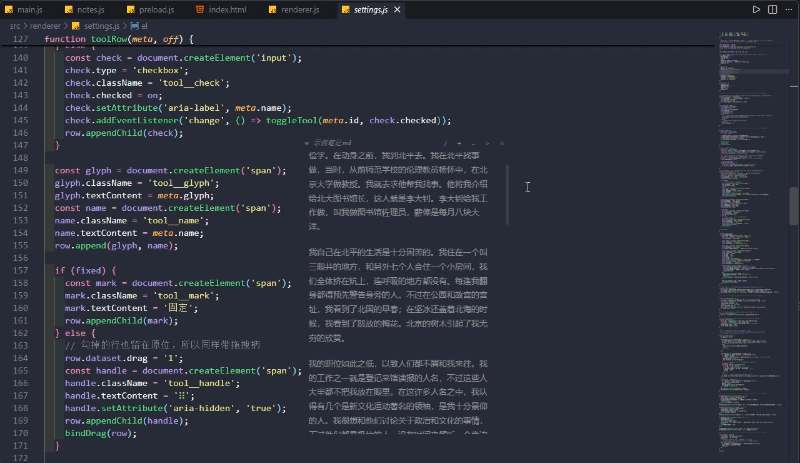
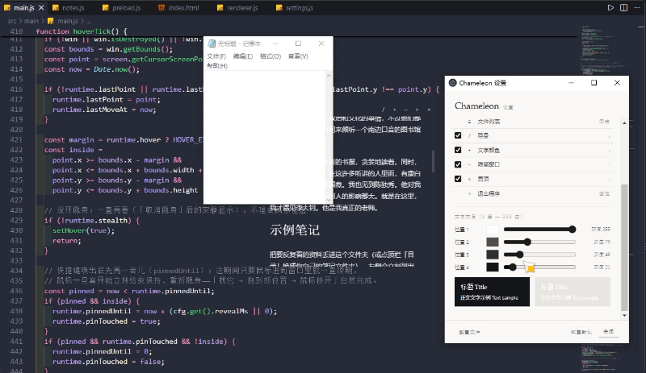

<div align="center">

# 变色龙 · Chameleon

上班摸鱼看文档，屏幕上不多出一个窗口。

[](../../releases)
[](https://www.electronjs.org/)
[](#)
[](LICENSE)

[简体中文](README.md) · [English](README.en.md)


</div>

图里浮在网页上面那段文字才是它。没有边框、没有底色、没有标题栏，屏幕上只多出来几个字。

## 这是干嘛的

上班时总要偷偷瞄两眼资料：接口文档、命令备忘、自己随手记的东西。开个阅读器吧，任务栏多一个图标，窗口还带着一大片底色，谁路过都看得见。

所以这个窗口里什么都不画，只画字。鼠标停住它才出来，你一走它就消失；消失之后鼠标点下去，点到的是下面那个程序，不是它。

名字是这么来的：变色龙不改造环境，只是变得和周围一样。

## 什么时候出现



鼠标在窗口范围里动来动去，它不会理你。停住了才淡入，默认等 0.6 秒；鼠标移开就自己淡出。

这两个时长都不是写死的。设置窗口里能改静止门槛，250 到 2000 毫秒随便拖；淡入淡出在配置文件里改，设成 0 就是直接切换，没有过渡。

## 换个背景也看得清



深色壁纸配白字，浅色文档配黑字。设置窗口里四个灰度值自己拖，顶栏的 `+` 按顺序循环，四档都会记住，不用每次重设。

## 平时这么用

1. 要看的 `.md` 放进一个文件夹
2. 把文件夹拖到 `Chameleon.exe` 上，不用先打开程序
3. 鼠标挪到屏幕角落停一下，文档出来，滚两行，移开
4. 有人过来，`Alt + Shift + Q` 收起来，连鼠标都不用找

窗口不占任务栏，也没有托盘图标，退出用顶栏最右边的 `×`。

## 快捷键

| 操作 | 结果 |
| --- | --- |
| 鼠标在窗口内停住（默认 0.6 秒） | 淡入，可以滚动、选中文字 |
| 鼠标掠过或还在动 | 不显示 |
| 鼠标移出窗口 | 淡出，恢复点击穿透 |
| `Alt + Shift + Q` | 唤出 / 隐藏 |
| `Ctrl + P` | 打开 / 关闭文件列表 |
| `Esc` | 列表开着就关列表，否则隐藏窗口 |
| `Ctrl + +` / `Ctrl + -` / `Ctrl + 0` | 字号放大 / 缩小 / 复位 |

窗口没有边框，四边四角都能拖着改大小，最小 120 × 80。

## 设置

设置单独放在一个窗口里，阅读窗口上一个按钮都不加。打开方式：桌面上的「Chameleon Settings」，或者 `Chameleon.exe --settings`。

| 项 | 说明 | 范围 |
| --- | --- | --- |
| 不透明度 | 显现时整体多透 | 0.15 ~ 1 |
| 静止显现门槛 | 鼠标要停多久才出来 | 250 ~ 2000 毫秒，默认 600 |
| 顶栏按钮 | 勾选显隐，按住行拖动排序 | — |
| 文字颜色 | 四个灰度值，自动按白到黑排序 | 0 黑 ~ 255 白 |

顶栏里文件列表 `≡` 固定在左边、退出 `×` 固定在右边，这两个不能藏；中间四个可以勾掉，也能拖着换位置。勾掉只是不显示，位置不会跑。

## 配置文件

在 `%APPDATA%\chameleon\config.json`。改完保存就生效，不用重启；写错了程序会把值钳回合法范围，不至于把窗口调没了。

常改的几个：`notesDir`（笔记目录）、`hotkey`、`hoverOpacity`、`inkTones`、`stillMs`、`fadeMs`、`revealMs`。顶栏的顺序和显隐分别记在 `tools` 和 `toolsOff` 里，两者分开，所以设置里取消勾选时行不会跳走。

## 从源码跑

需要 Windows 和 Node.js 20。

```powershell
git clone https://github.com/McQueen979/chameleon.git
cd chameleon

# 国内网络下 Electron 的二进制要走镜像
$env:ELECTRON_MIRROR='https://npmmirror.com/mirrors/electron/'
npm install

npm start          # 正常运行
npm run dev        # 带开发者工具，会打运行日志
npm run build      # 出免安装版
```

`npm run build` 不联网：直接拿 `node_modules` 里已经下好的 Electron 拼一个绿色目录出来，产物在 `dist\Chameleon`，顺手在桌面建两个快捷方式。不需要 electron-builder，也不用装 NSIS。

## 目录

```
chameleon/
├─ src/
│  ├─ main/       窗口、悬停显隐、点击穿透、配置读写、Markdown 渲染
│  ├─ preload/    contextBridge 白名单
│  └─ renderer/   阅读界面与设置窗口
├─ docs/          截图和演示图
├─ build.ps1      免安装版构建脚本
├─ CHANGELOG.md
└─ package.json
```

## Markdown

标题、列表、引用、代码块、表格、分隔线这些常规语法都支持。笔记之间的相对链接在窗口里直接跳过去，`http(s)` 链接交给系统浏览器。

原始 HTML 标签按文字显示，裸 URL 不会自动变成链接，`- [ ]` 也只是普通文字。图片不加载，因为窗口把外部资源请求全关了，文字照常显示。

以前有个坑：笔记里只要出现一个链接，整篇就渲染不出来。现在加了兜底，单篇出问题最多退化成纯文本，不会整篇空白。

## 一些限制

- 只有 Windows 版，纯只读，没有编辑功能
- 只认 `.md` 和 `.markdown`
- 文件列表每次打开扫一遍，不会实时监听；只能按文件名筛，没有全文搜索
- 换笔记文件夹得改配置文件，程序里没有切换入口
- 字色要自己按背景挑，它不会去采样下层画面
- 阅读位置按像素记，改过字号再打开可能偏一点
- 快捷键被别的程序占了的话，双击程序也能唤出来

## 版本

版本号走语义化版本，每次改动记在 [CHANGELOG.md](CHANGELOG.md)，下载在 [Releases](../../releases)。

## 许可证

MIT。
